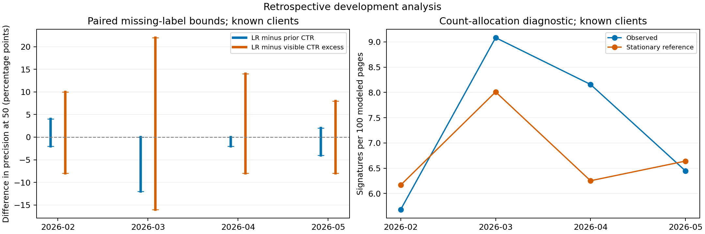
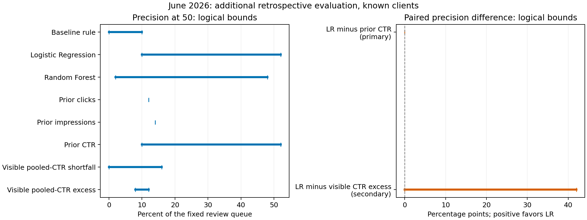

# Prioritizing pages for click-decline review: learned scores versus simple rules

Author: Ridoy Hasan · FlyRank ML Internship · Updated 6 November 2026

## Abstract

Can a learned score improve which pages a content strategist reviews first for a later click decline? We compared fixed logistic regression and random forest models with six simple ranking rules using four prior search measurements, equal 28-day windows, past-only training and a review budget of 50 pages. For known clients, the difference in precision between logistic regression and prior CTR was bounded by −2 to 0 percentage points in April and −4 to +2 in May; in June the queues shared 49 of 50 pages and their paired difference was zero. June was a disclosed retrospective rerun after a runtime reset and an earlier source-quality inspection, and 21 outcomes shared by its two primary queues remained unknown. These comparisons do not establish added value from the learned ranking for this task, and do not establish general equivalence, a cause of decline or a benefit from editing pages.

## Introduction / problem statement

The decision is which 50 eligible pages a strategist reviews first. The target is a defined pattern: clicks fall by at least 15% while impressions remain within ±10% of their earlier level. Finding this pattern is a review aid; it does not explain why a page lost clicks.

The question is whether a learned ranking adds value beyond inexpensive historical rules. Earlier exploratory versions compared unequal calendar windows and relied on a weak baseline. Their numerical results and page-group counts are superseded here rather than mixed with the corrected evaluation.

This is a retrospective comparative evaluation with reproducible code and public aggregate results. Its contribution is the documented comparison and treatment of unavailable outcomes in this review task. It does not introduce an algorithm, replicate a named published experiment, or establish that this question has not been studied before.

## Related work and methodological context

Kapoor and Narayanan document how leakage can undermine claims of model superiority [1]. Wild-Time studies evaluation under temporal distribution shifts [2]. These motivate explicit timing and comparator checks here; neither establishes the cause of this study's results. Click-feedback research also shows that position influences clicks [3], so a click-based event cannot independently identify content quality. This project's page-review task differs from ranking search results in that literature.

Chiolero and colleagues discuss mathematical coupling, measurement error and regression to the mean when relating a baseline value to later change [4]. These are relevant because prior counts appear both in this study's predictors and its event definition. Their continuous-outcome analysis does not directly validate this thresholded count label or prove that regression to the mean explains its events.

Saito and Rehmsmeier discuss precision-recall evaluation for imbalanced classification [5]. Here, the assumed review capacity additionally motivates precision at a fixed budget. REFORMS provides reporting guidance for validity and reproducibility [6]. These references contextualize the methods and limitations; they are not an exhaustive literature review, a claim of formal checklist compliance, or evidence of a new research gap.

## Data

The source is the gated FlyRank internship warehouse, release v20260703, at dataset revision 50cbf7c3909d07be4d1b5906b4d09e882e5acbf2. The corrected analysis uses fact_content_daily_performance: October 2025–May 2026 partitions provide historical windows, and June 2026 provides the additional outcome window. It does not use the final-month sample, query table, GA4 fields or static content metadata.

A page is the pair of client and content identifiers; the daily key additionally includes the report date. Identifiers serve only joins, client splits and stable tie ordering. A candidate must have 28 explicitly available prior daily records, positive prior impressions and clicks, and a finite positive impression-weighted position. Missing days are not filled with zero. These eligibility rules exclude zero-prior-click and incomplete-history pages, so findings do not describe those pages.

An outcome is observed only with 28 valid available later daily records. Otherwise the label is unknown and the page remains in its original review queue. The table reports known-client populations separately by evaluation origin; repeated pages across origins are not independent observations. The positive rate uses observed labels only.

| Outcome month | Eligible pages | Clients | Observed labels | Positive labels | Positive rate among observed |
| --- | --- | --- | --- | --- | --- |
| 2026-02 | 32,044 | 22 | 30,237 | 1,722 | 5.7% |
| 2026-03 | 38,331 | 21 | 32,180 | 2,917 | 9.1% |
| 2026-04 | 37,923 | 23 | 34,201 | 2,809 | 8.2% |
| 2026-05 | 41,470 | 24 | 38,116 | 2,474 | 6.5% |
| 2026-06 | 54,046 | 34 | 46,096 | 2,304 | 5.0% |

## Methodology

For an evaluation origin t, features cover t−31 through t−4, the next three date labels are unused, and outcomes cover t through t+27. Training uses exactly the three most recent episode origins whose outcome windows finish by t−4. The table gives the resulting dates; March and May cannot use the immediately preceding episode because its labels have not matured.

The four predictors are prior impressions, prior clicks, CTR (100 × clicks/impressions) and impression-weighted average search position. The positive label satisfies 9 I0 ≤ 10 I1 ≤ 11 I0 and 20 C1 ≤ 17 C0, where I and C are impressions and clicks in the prior (0) and outcome (1) windows. This count-based label is an operational definition, not independently verified content harm.

CTR is derived from clicks and impressions, so the four columns are not four independent information sources. Prior clicks also enter the event threshold. Using an earlier measurement is not automatically future leakage, but the connection between baseline level and later change limits a mechanistic interpretation [4]. Integer inequalities make the chosen threshold boundaries exact; they do not establish that the thresholds identify persistent deterioration.

Logistic regression uses C=1, at most 1,000 iterations and seed 42. The random forest uses 300 trees, seed 42 and scikit-learn 1.7.2 defaults. Each uses a separate standardization pipeline. The same fixed settings are retained for every supported evaluation; there is no June model search.

The six rules are the original position-band median-CTR shortfall, prior clicks, prior impressions, prior CTR, and visible position-band pooled-CTR shortfall and excess. All rule references use training features only. Visibility means impressions at least the training median; position bands have boundaries 0, 3, 10, 20, 50 and infinity. Shortfall ranks below-reference CTR; excess ranks above-reference CTR. The original rule remains as a comparator rather than the only rule to beat.

Evaluations distinguish clients represented in labelled training, naturally unseen clients, and a permanent client-hash holdout excluded from its corresponding training. IDs, outcome-window measurements and product decision scores are not predictors. Candidate selection and rankings precede outcome attachment. The final warehouse does not contain historical ingestion vintages, so the three-day availability buffer remains an assumption.

The main budget is 50 eligible pages, including unknown outcomes. With h observed positives and u unknown labels, precision lies between h/50 and (h+u)/50. These are logical ranges, not confidence intervals. For paired comparisons, common pages cancel, including common unknown outcomes. If d is the known-positive difference on exclusive pages and uA/uB are their unknown counts, the difference is bounded by (d−uB)/50 and (d+uA)/50. June’s primary comparison is logistic regression minus prior CTR for known clients.

The budget of 50 represents an assumed review capacity, not an empirically optimized business policy. Precision measures retrieved event pages; it does not measure recovered clicks, revenue, or the effect of editing. Complete-case ROC AUC and average precision describe only pages with observed labels and cannot resolve missingness in the original queue.

Other client groups, methods, budgets (25, 100, 200), prior-click thresholds and complete-case ROC AUC/average precision remain available in the aggregate artifacts. Client deletion reranks fixed scores without refitting. The existing count-allocation diagnostic uses future counts and is descriptive; it is neither a forecast nor a false-positive estimate.

| Evaluation origin | Feature window, 2026 | Outcome window, 2026 | Training episode origins |
| --- | --- | --- | --- |
| 2026-02-01 | Jan 01–Jan 28 | Feb 01–Feb 28 | 2025 Nov, Dec; 2026 Jan |
| 2026-03-01 | Jan 29–Feb 25 | Mar 01–Mar 28 | 2025 Nov, Dec; 2026 Jan |
| 2026-04-01 | Mar 01–Mar 28 | Apr 01–Apr 28 | 2026 Jan, Feb, Mar |
| 2026-05-01 | Mar 31–Apr 27 | May 01–May 28 | 2026 Jan, Feb, Mar |
| 2026-06-01 | May 01–May 28 | Jun 01–Jun 28 | 2026 Mar, Apr, May |

## Results

The known-client paired comparisons below show no strictly positive lower bound for added logistic-regression precision over prior CTR. April and May were later periods under a protocol fixed after earlier exploration. All periods are retrospective. Ranges concern these fixed queues and do not establish equivalence across portfolios or future periods.

| Outcome month | Shared top-50 pages | LR minus prior CTR, logical precision bounds |
| --- | --- | --- |
| 2026-02 | 41/50 | -2 to 4 pp |
| 2026-03 | 35/50 | -12 to 0 pp |
| 2026-04 | 44/50 | -2 to 0 pp |
| 2026-05 | 43/50 | -4 to 2 pp |
| 2026-06 | 49/50 | 0 to 0 pp |

Earlier chronological evaluation. The archived figure summarizes the February–May known-client queues and paired comparisons. Wider ranges reflect unknown outcomes; they are not statistical confidence intervals.

## June comparison

June’s known-client population contained 54,046 eligible pages from 34 clients; 46,096 had observed labels, including 2,304 positives (5.0% of observed labels). Logistic regression and prior CTR each selected five observed positives and 21 unknown outcomes among 50 reviews. Their shared 49 pages contained all 21 unknowns, while both exclusive pages were observed negatives. Their paired precision difference is therefore zero even though either queue’s absolute precision remains between 10% and 52%.

Outcome coverage is worse in the selected queues than in the full eligible known-client population: 7,950 of 54,046 outcomes (14.7%) are unknown overall, compared with 21 of 50 (42%) in each primary queue. The reason for this concentration has not been established. The 5.0% observed-label event rate is not a measured prevalence for all eligible pages, so it does not support a precise whole-population lift estimate for these queues.

The table retains all eight rankings at the same budget. Unknown labels prevent treating observed hits divided by 50 as fully measured precision. These results do not select a new winning method after inspecting June.

| Ranking | Observed positives / 50 | Unknown / 50 | Precision bounds |
| --- | --- | --- | --- |
| Baseline rule | 0 | 5 | 0 to 10% |
| Logistic Regression | 5 | 21 | 10 to 52% |
| Random Forest | 1 | 23 | 2 to 48% |
| Prior clicks | 6 | 0 | 12 to 12% |
| Prior impressions | 7 | 0 | 14 to 14% |
| Prior CTR | 5 | 21 | 10 to 52% |
| Visible pooled-CTR shortfall | 0 | 8 | 0 to 16% |
| Visible pooled-CTR excess | 4 | 2 | 8 to 12% |

June known-client comparison. Left: each line spans the possible precision given unknown labels. Right: common pages cancel when comparing queues; LR and prior CTR have a zero paired difference. The wider secondary LR-minus-CTR-excess range includes zero.

## Existing checks on event interpretation

The archived June results already include minimum-prior-click checks. The table reports the unchanged LR scores reranked after restricting eligibility; prior CTR has the same hit and unknown counts at each threshold. No model is refitted. These checks concern different candidate populations and do not establish that changing the threshold improves the original policy.

| Minimum prior clicks | Eligible known-client pages | LR observed positives / 50 | LR unknown / 50 | LR precision bounds |
| --- | --- | --- | --- | --- |
| 1 | 54,046 | 5 | 21 | 10 to 52% |
| 5 | 25,290 | 5 | 21 | 10 to 52% |
| 20 | 8,166 | 6 | 8 | 12 to 28% |

Among observed June labels, event rates are 3.4% for pages with 1–4 prior clicks, 5.2% for 5–19, and 8.8% for 20 or more. Observation coverage also differs between these groups. The results therefore do not justify attributing all events to low prior counts; neither do they establish that the events represent content deterioration.

The existing count-allocation diagnostic conditions on both windows' impression totals, their combined clicks, and positive prior clicks under an independent-click, constant-CTR reference. On its June known-client subset of 45,339 complete-case pages with at most 200 combined clicks, it reports 2,203 events and approximately 1,932 expected under that reference. It uses future information and is descriptive. The difference has no supplied calibrated significance interpretation and cannot be read as a count of genuinely harmed pages. Changing CTR, dependent clicks, and outcome-dependent observation can invalidate the reference assumptions. Aggregate inputs and calculations are in the linked June results.

## Other client groups and source-quality recovery

The June groups below overlap: the hash holdout is a separate training/evaluation design, not an independent sample to pool with the other groups. A small number of clients dominate the two non-primary groups; their detailed results are retained in the June JSON.

The first June execution stopped because 355 global page groups contained duplicate daily keys (5,680 extra rows). None overlapped its frozen candidate population. That Colab runtime later expired and its private score and source checkpoints were lost. The recovery repeated the same model computation, recorded the prior source inspection before execution, and preserved the unchanged scientific protocol.

The rerun reproduced the 355 failed global groups. It preserved the global audit and validated June source rows for all and only the May-selected candidates; 55,957 candidate groups had June source rows and none failed the grain/count/coverage checks. It performed no deduplication, removed no candidates and retained absent/incomplete outcomes as unknown. The original prediction bytes and timestamps cannot be recovered or verified. This is additional retrospective validation, with no blind or prospective claim.

| June evaluation group | Eligible pages | Clients | Pages from largest two clients |
| --- | --- | --- | --- |
| known clients | 54,046 | 34 | 41.8% |
| naturally unseen clients | 1,911 | 7 | 90.2% |
| hash heldout clients | 16,710 | 9 | 88.3% |

## Limitations and honest framing

The target measures a particular count pattern. Small positive prior-click counts can produce large percentage changes. A positive signature does not identify an AI-search effect, a content-quality defect, lost business value or a causal effect of a page edit.

Eligibility excludes incomplete prior histories and zero prior clicks. Later missingness need not be random: 42% of labels in June’s primary top-50 queues are unknown. Complete-case metrics concern a different evaluation population. Repeated pages, overlapping client designs, few evaluation periods and client concentration limit generalization.

Model settings and comparisons were developed retrospectively. Earlier June exposure was uncertain, its source defects were inspected before the recovery rerun, and the warehouse provides final values rather than deployment-time data vintages. The evidence supports a limited failure to demonstrate added retrieval value here; it does not show that machine learning never helps this problem.

The comparison covers fixed LR and RF settings with a restricted numerical feature set. It does not estimate the best achievable performance of ML. Multiple features, windows, populations and comparators changed during earlier repairs, so differences from superseded results cannot be attributed to a single correction. Stable total impressions do not hold query mix, device mix or search-result exposure constant [3].

## Ranked recommendations / action playbook

The following is a proposed human review process, not an experimentally validated editing policy. The current evidence does not justify choosing the more complex learned ranking over the simple CTR comparator for June’s primary comparison. Private page-level rankings remain in the approved environment; public outputs contain aggregate evidence only.

| Order | Proposed action | Reason and limit |
| --- | --- | --- |
| 1 | Use prior CTR as a transparent reference queue; review at most 50 eligible pages. | Rank by descending prior CTR with stable tie ordering. This is a low-complexity reference, not a proven universal winner. |
| 2 | Verify measurement and inspect each queued page before deciding an action. | Check availability and the underlying click/impression pattern. A score alone does not diagnose a cause or justify an edit. |
| 3 | Record the review decision and monitor remaining eligible pages. | An unselected page is not certified healthy. Validate any proposed editing benefit separately. |

## Reproducibility

The capstone notebook verifies the archived aggregate hashes and regenerates the tables in this paper. It does not refit models or query gated data. The underlying development and June recovery notebooks contain the fitting and warehouse code; their execution records are retained separately. The clean development notebook completed 11 code cells in an existing approved Colab VM using a verified cache, not a fresh independent data collection. The June recovery completed 14 code cells and 13 software tests; its exported artifact hashes were checked locally.

Public report replay, synthetic software tests, and source-to-model reproduction establish different things. Hash agreement establishes consistency with stored artifacts, not correctness of the label or independent validation of the source. The existing GitHub smoke-test workflow primarily runs the bundled starter pipeline and delivery checks; a green run must not be described as executing all research tests. This revision adds context and summaries of archived diagnostics without changing the models, scientific protocol or recorded results.

Pinned versions are NumPy 2.2.6, pandas 2.2.3, SciPy 1.16.3, scikit-learn 1.7.2, Matplotlib 3.10.7, DuckDB 1.4.1 and huggingface_hub 1.0.1. Provider access and private caches are needed to repeat warehouse computation. Credentials, raw page identifiers, private queries and score arrays are excluded from public artifacts. Earlier assignment outputs remain historical and must not be substituted for these corrected results.

- [Capstone aggregate-verification notebook](https://github.com/ridoy1211/Flyrank-Internship-ML/blob/main/work/notebooks/capstone.ipynb)
- [Development computation notebook](https://github.com/ridoy1211/Flyrank-Internship-ML/blob/main/work/research/FlyRank_clean_research.ipynb)
- [June recovery computation notebook](https://github.com/ridoy1211/Flyrank-Internship-ML/blob/main/work/research/FlyRank_June_recovery.ipynb)
- [Development aggregate results](https://github.com/ridoy1211/Flyrank-Internship-ML/tree/main/work/research/results/verified_development_v1)
- [June aggregate results and recovery disclosure](https://github.com/ridoy1211/Flyrank-Internship-ML/tree/main/work/research/results/june_recovery/20261105T181747Z)
- [June protocol](https://github.com/ridoy1211/Flyrank-Internship-ML/blob/main/work/research/protocols/june_retrospective_v2.json)

## Acknowledgments and data credit

Built on the FlyRank ML Internship dataset. Ridoy Hasan conducted this internship project with AI-assisted code and editorial support; the methods, results and limitations are documented for review.

- [FlyRank](https://flyrank.ai)

## References

The links below provide the versions used for this methodological context. Entries linked through arXiv are cited as those arXiv versions.

- [1] Kapoor, S., and Narayanan, A. (2022). [Leakage and the Reproducibility Crisis in ML-based Science](https://arxiv.org/abs/2207.07048). arXiv:2207.07048.
- [2] Yao, H., Choi, C., Cao, B., Lee, Y., Koh, P. W., and Finn, C. (2022). [Wild-Time: A Benchmark of in-the-Wild Distribution Shift over Time](https://arxiv.org/abs/2211.14238). arXiv:2211.14238.
- [3] Joachims, T., Swaminathan, A., and Schnabel, T. (2016). [Unbiased Learning-to-Rank with Biased Feedback](https://arxiv.org/abs/1608.04468). arXiv:1608.04468.
- [4] Chiolero, A., Paradis, G., Rich, B., and Hanley, J. A. (2013). [Assessing the relationship between the baseline value of a continuous variable and subsequent change over time](https://www.researchgate.net/publication/259355684_Assessing_the_Relationship_between_the_Baseline_Value_of_a_Continuous_Variable_and_Subsequent_Change_Over_Time). Frontiers in Public Health, 1:29. DOI: 10.3389/fpubh.2013.00029.
- [5] Saito, T., and Rehmsmeier, M. (2015). [The Precision-Recall Plot Is More Informative than the ROC Plot When Evaluating Binary Classifiers on Imbalanced Datasets](https://www.researchgate.net/publication/273155496_The_Precision-Recall_Plot_Is_More_Informative_than_the_ROC_Plot_When_Evaluating_Binary_Classifiers_on_Imbalanced_Datasets). PLOS ONE, 10(3):e0118432. DOI: 10.1371/journal.pone.0118432.
- [6] Kapoor, S., et al. (2023). [REFORMS: Reporting Standards for Machine Learning Based Science](https://arxiv.org/abs/2308.07832). arXiv:2308.07832.
